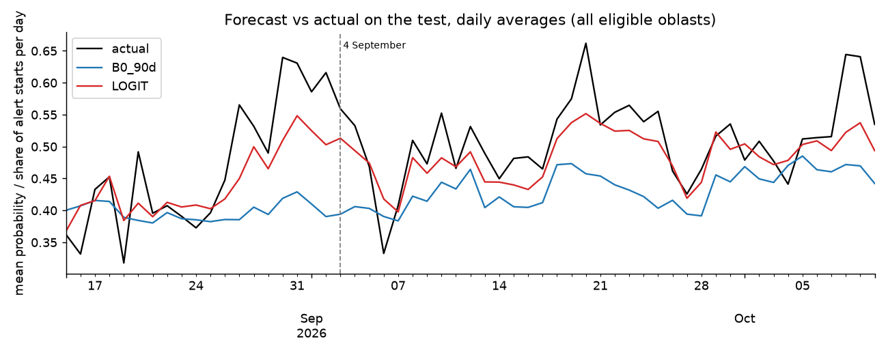
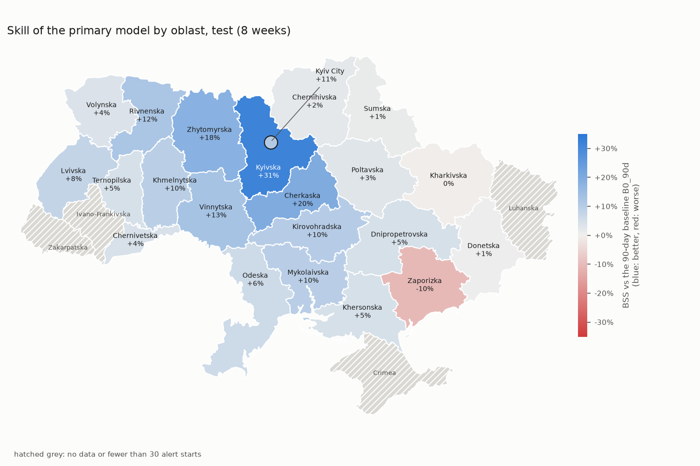
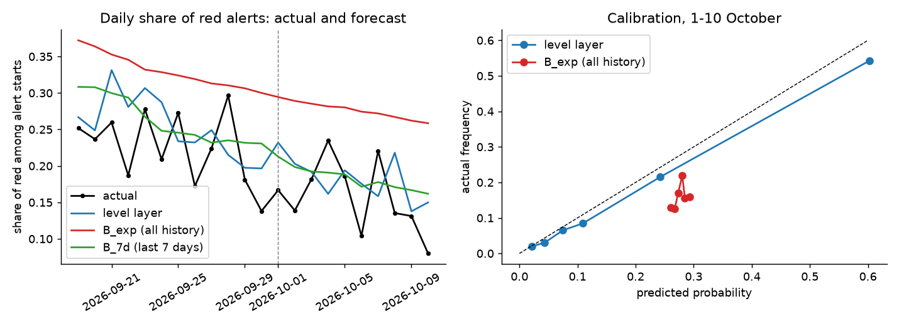
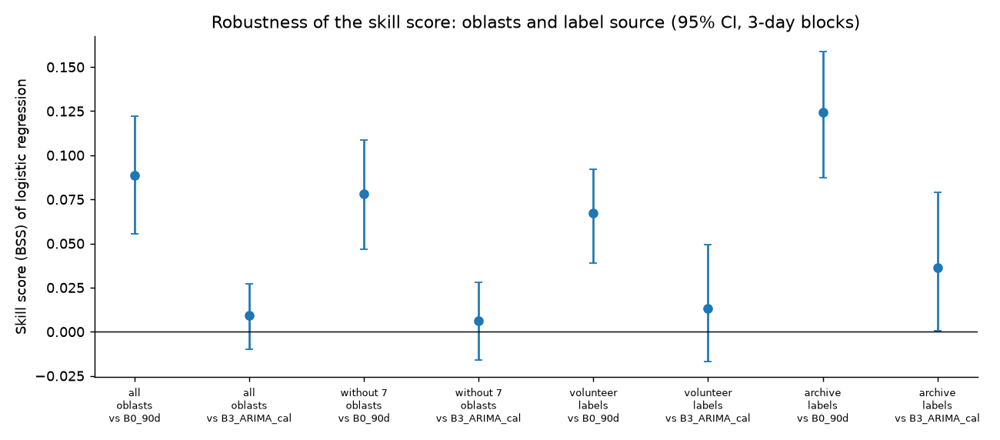

# Air-raid alert forecasting in Ukraine

How likely is it that a **new air-raid alert starts in a given region (oblast) within the next 3 hours?** This project answers that for all 24 oblasts (including Kyiv City; Luhansk is excluded), every hour, using only information that was available at the moment of the forecast.

**In short**
- A logistic regression forecasts better than simple "how often did alerts start here at this hour" baselines. On the last 8 weeks of data, tested once, its error is about 9% smaller than the 90-day baseline's (skill score **+0.089**, 95% CI +0.056 to +0.122).
- Against the *strongest* baseline on that test (an ARIMA-based one) the difference is small and not statistically reliable (+0.0095, CI −0.010 to +0.027).
- The success rule we set in advance is met, but the conclusion is limited. The main reasons are in [Limitations](#5-limitations).

**How to read the numbers.** *Brier score* is the average squared error of the forecast probabilities (lower is better). *Skill score* compares a model with a baseline: `1 − Brier(model) / Brier(baseline)`. Zero means "no better than the baseline", a positive value means better. *CI* is the 95% range of plausible values.

## 1. Task and scope

- **Question:** at hour *t*, in an oblast with no alert active, what is the probability that a new alert starts within the next 3 hours?
- **Data:** a snapshot downloaded on 2026-10-10, the freshest available then, and pinned for reproducibility (the source repositories add new data daily, so later snapshots reach past this date). The **test** is the last 8 weeks. The verdict was computed once, after all choices were made; later descriptive checks (alert levels, robustness, text) look at parts of the same period and do not change it.
- **No peeking at the future:** neither training nor features use anything that happened after the forecast moment.

## 2. Reproducibility

```bash
python3.14 -m venv .venv && source .venv/bin/activate
pip install -r requirements.txt
make test     # 53 test cases (one needs the downloaded data and is skipped without it), about 1 min in a fresh environment
make all      # downloads data, runs every stage, ~12 min; rewrites reports/
```

- **Python version.** Developed and verified on **Python 3.14.8** only (development and the clean-copy check used the same version). The pinned packages need at least Python 3.12 (numpy and scipy, per their package metadata); other Python versions were not tested.
- Data are downloaded from **fixed commits** and checked by hash (`src/download_data.py`), so numbers do not change when the source repositories update. Package versions are pinned.
- Checked from a clean clone of the pushed repository (fresh virtual environment, `make all`; the optional text experiment is not part of this check): all 53 tests pass, every table in `reports/tables/` matches (only a run-time column differs) and all figures are identical. Verified on Apple Silicon (macOS); other platforms may differ in the last digits.
- **Not reproducible by code:** the analysis of raw Telegram messages behind the parser findings (see [Limitations](#5-limitations)). The optional text experiment (`make telegram text`, not part of `make all`, about 150 MB, tens of minutes to download) reads a live channel, so a re-download gives a different set of messages.

## 3. Method

Each point is one short paragraph; the link leads to the details.

- **Data.** Two alert histories (volunteer-collected and official) and an alerts.in.ua archive that has alert levels. The volunteer history is the main one: it is the longest and the freshest. → [`reports/data_audit.md`](reports/data_audit.md)
- **What is forecast.** One row per oblast and hour, only when no alert is active at that moment. An alert with no recorded all-clear counts as still active, as it would for a live system. → [`docs/problem_statement.md`](docs/problem_statement.md)
- **Test setup.** Four consecutive 4-week periods before the test are used to compare models and tune settings, with a 4-hour gap between training and the period being predicted. The success rule was fixed before the test: the 95% interval of the skill score against the best baseline from validation must lie above zero. → [`docs/methodology_details.md`](docs/methodology_details.md)
- **No leakage.** Every feature uses only alerts that had started, and all-clears that had been recorded, by the forecast moment. 53 automated test cases check this (cutting history at the forecast moment, changing the future, boundary cases). We also deliberately introduced leaks to confirm the tests catch them. → [`tests/`](tests/)
- **Baselines.** Alert frequency by oblast and hour of day over 28 and 90 days, a trailing 90-day rate, a seasonal logistic model, and classical time-series models (ETS, ARIMA) with and without a recalibration step (probabilities adjusted using past data). → [`reports/baselines_val.md`](reports/baselines_val.md)
- **Models.** 31 features in 7 groups (current alert state, recent counts, past frequencies, neighbouring oblasts, whole country, calendar, oblast). Logistic regression is the primary model, gradient boosting the secondary one. Dropping one feature group at a time on validation shows that past frequencies and the oblast's own recent counts matter most; neighbours, whole country, calendar and oblast add little or nothing, and the gains from any group are small. → [`reports/model_val.md`](reports/model_val.md)

## 4. Results

**Test: last 8 weeks, 23,561 forecasts.**

| Model | Brier score | Skill vs 90-day baseline | Skill vs best test baseline |
|---|---|---|---|
| 90-day frequency baseline | 0.1743 | 0 | n/a |
| 28-day frequency baseline | 0.1644 | n/a | n/a |
| ARIMA with recalibration (best baseline on the test) | 0.1603 | n/a | 0 |
| **Logistic regression (primary)** | **0.1588** | **+0.089 [+0.056; +0.122]** | +0.0095 [−0.010; +0.027] |
| Gradient boosting (secondary) | 0.1572 | +0.098 [+0.065; +0.131] | +0.019 [+0.002; +0.036] |

Details by oblast, hour and before/after the 4 September regime change: [`reports/test_results.md`](reports/test_results.md).



*Daily average forecast probability vs the actual share of alert starts on the test. Black: actual, red: logistic regression, blue: 90-day baseline. The baseline stays flat while the real rate rises; the model follows the trend but underestimates the peaks.*



*Skill of the logistic regression against the 90-day baseline in each oblast. Right of zero means better than the baseline; grey bars have fewer than 30 alert starts and are not interpreted. It is worse than the baseline in Zaporizka (about −0.10) and Kharkivska (about −0.004).*

**Alert levels (yellow and red).** Levels exist for only about 5 weeks, so this part is descriptive. A layer that estimates the chance that an alert is red, scored on the last 9 days, has Brier 0.0975, against 0.1347 for a 7-day baseline and 0.1476 for an all-history baseline. → [`reports/levels.md`](reports/levels.md)



*Left: share of red alerts per day (black) falls over the period; the layer (blue) follows it better than the all-history baseline (red). Right: calibration on the last 9 days.*

**Text data (optional extra).** Message counts from the public Air Force channel (how many messages in the last 1 and 3 hours mention the oblast, and how many in total) were added to the logistic regression. They were chosen on validation (better in all four periods) and then tested once: Brier 0.1560 against 0.1578 for the same model without text, skill score +0.0117 (95% CI +0.0035 to +0.0199). Against the strongest baseline (ARIMA with recalibration) it is +0.027 (CI +0.006 to +0.049), but this comparison was added after the run and the text model, unlike the main one, was not fixed before the test, so the verdict stays with the main model. → [`reports/text.md`](reports/text.md)

**Robustness.** With labels taken from the independent alerts.in.ua archive, the skill score against the 90-day baseline is +0.124 [+0.087; +0.159]. Without 7 oblasts where the volunteer series defines an alert start differently, it is +0.078 [+0.047; +0.109]. Neither changes the verdict. → [`reports/robustness.md`](reports/robustness.md)



*Skill of the logistic regression under the checks above (points) with 95% intervals; against the strongest baseline most intervals include zero.*

## 5. Limitations

- **Small margin over the strongest baseline.** The 90-day baseline was best on validation but not on the test: the share of alert starts rose and a long window reacts slowly. Much of the gain over it comes from the baseline getting worse, not from the model getting better.
- **The volunteer history is not a clean ground truth.** Its parser overwrites an alert's start when a repeated start message arrives within 3 hours, the message format changed over time, and "an alert start" means different things in different oblasts. How much this affects the scores is unknown. Independent labels (see Robustness) point the same way but do not remove the problem.
- **Choices made on the same validation periods:** baseline, settings and recalibration. The intervals do not account for this, and the data audit had also seen the test-period base rate.
- **Short test across a regime change:** alert levels were introduced on 4 September.
- **Alert levels:** about 5 weeks of data and a changing share of red alerts. The combination "alert starts" × "alert is red" was not evaluated because the two sources define a start differently.
- **Right edge of the data.** The latest hours of the snapshot may be incomplete, so the forecast grid ends at 2026-10-10 01:00 UTC, 3 hours before the hour of the latest observed alert. Every forecast then has a complete 3-hour target window.
- **Synthetic end times and non-stationarity.** About 5% of end times in the volunteer history are synthetic (start + 30 minutes) and are never used as features. Alert frequency and message format changed over time, so older data may describe a different regime.
- **Text data (optional extra): selected on validation, but not fixed before the test.** The variant (alert counts from the Air Force channel) was chosen on validation, no tuning, and run once on the test. Part of the test had already been seen in an earlier, shorter run. The intervals do not include the choice between two feature variants. The channel's post volume grew about 3.5 times over the period. Details: [`reports/text.md`](reports/text.md).
- Luhansk is excluded. Very long alerts and an anomaly on 2026-04-17 are described in the audit. Numbers under the dataset's own labelling scheme contain retrospective information.

**What to do next**
1. Collect the raw message stream to measure how much the parser's overwriting affects eligibility and scores.
2. Evaluate the whole chain (start × level) against red alert starts from an independent source.
3. Re-test on a longer period of the new alert regime.
4. Try the alternative target "an alert is active in the window", which needs no eligibility filter.
5. Re-check on the official series.

## 6. Additional materials

**Data sources and credits**
- Volunteer and official alert histories: [Vadimkin/ukrainian-air-raid-sirens-dataset](https://github.com/Vadimkin/ukrainian-air-raid-sirens-dataset) (MIT per repository metadata). The volunteer history is built from the eTryvoga Telegram channel; the parser code was read to understand the data.
- Alert levels: alerts.in.ua archive from [JustJimer/ukraine-air-alert-stats](https://github.com/JustJimer/ukraine-air-alert-stats). License not verified.
- Text experiment: public Telegram channel of the Air Force of Ukraine ([t.me/s/kpszsu](https://t.me/s/kpszsu)), pages from 2026-03-26 downloaded on 2026-10-11, not stored in the repository.
- Oblast adjacency was checked against OpenStreetMap-based boundaries ([EugeneBorshch/ukraine_geojson](https://github.com/EugeneBorshch/ukraine_geojson)).
- Terms of use of the Telegram channels (the one behind the volunteer history and the Air Force channel) were not checked.
- Pinned commits and file sizes: [`src/download_data.py`](src/download_data.py).

**Repository layout.** `src/airalerts/` (package), `src/run_*.py` (stages), `tests/`, `reports/` (results, tables, figures), `docs/` (problem statement, definition of done, methodology details). Reports and docs are in Ukrainian, and so are the figures of the data audit and validation (01–13); figures 14–20 are in English.

**License.** The code is under the [MIT License](LICENSE). The data are not part of this repository and keep the terms of their original sources.

**Note on git history.** The commits were created at the end of the project, grouping the final state of files by logical stage (from problem statement to test results and README). The history is therefore not chronological: it does not show the order in which the work was actually done, and intermediate commits are not guaranteed to pass the tests on their own.

## 7. Reflection

I planned to forecast how many alerts there would be per day. AI suggested the same. I chose a harder question instead: will an alert start in a region in the next 3 hours?

The data gave me the most trouble: duplicates in the official file, and fake end times in about 5% of alerts. I used only end times already known at forecast time.

My first plan had no success rule. I wrote one before the test and ran it once.

The model beats a simple baseline, but not the strongest one reliably. The result is modest, but we can trust it.
